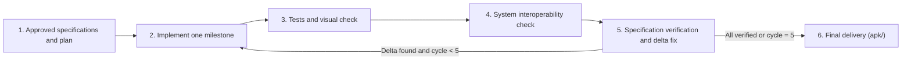

# Rule: Iterative Development & Verification Loop

## Overview

This rule governs the development and verification workflow after the discovery interview and the plan. Once the requirements are fixed in `specifications.md` and the plan is approved, implementation MUST proceed in an **iterative loop** that combines code generation, automated tests, visual inspection (screenshots and recordings), and checks of how the app interacts with the Android system.

---

## The iterative cycle

Each cycle has four sequential phases.

### 1. Focused implementation

- Implement one milestone at a time, strictly according to `specifications.md`, the approved plan, and `development-standards.md`.
- Keep changes modular, concise, and focused on the acceptance criteria. Do not add unrequested abstractions or features.

### 2. Testing and visual verification

- **Automated tests:** run the unit tests (`./gradlew testDebugUnitTest`), lint, and instrumentation tests where they exist. They verify business logic and state transitions.
- **Visual inspection (screenshots and recordings):**
  - Run the app on an emulator or a connected device.
  - Capture screenshots (`adb exec-out screencap -p > <path>.png`) or screen recordings (`adb shell screenrecord ...`) of the changed screens and flows.
  - Open the captures with an image-viewing tool and check that they match the Material 3 Expressive guidelines:
    - No hardcoded colors. Container and `on<Role>` tokens are paired correctly.
    - The surface container tonal hierarchy is respected, with no drop shadows.
    - Typography uses Google Sans Flex with the 30 M3 styles (see `spark-jetpack` section 6). Padding follows the 8dp grid. Shapes follow the shape scale.
    - Interactive transitions use spring physics, with the snappy timings.

### 3. Deep system interoperability and OS checks

Test how the app interacts with the Android system and with other apps:

- **System intents and sharing:** `ACTION_SEND`, `ACTION_VIEW`, the system share sheet and deep links. Null results and cancellations are handled gracefully.
- **File providers and pickers:** URI permissions, the Photo Picker, document access, and secure file sharing.
- **Notifications and background work:** notification channels, heads-up notifications, action buttons, and `PendingIntent` back stacks.
- **Hardware and device capabilities:** permission flows (contextual requests, graceful fallback when refused).
- **Configuration and lifecycle resilience:** rotation, process death, and the system back gesture (predictive back) must not crash the app or lose input (`rememberSaveable` or `SavedStateHandle`).

### 4. Specification compliance and delta fix

- Check every requirement in `specifications.md` against the test and visual evidence.
- When a regression, a visual flaw, or a functional gap is found, record the exact delta and fix it in the next cycle.

---

## Loop guards and optimization rules

1. **Hard limit of 5 cycles (no endless loops):**
   - The loop NEVER exceeds 5 cycles.
   - If minor edge-case discrepancies remain after cycle 5, close the iteration, document the remaining non-blocking items, and present the current build and APK to the user for a decision.
2. **Fast convergence:**
   - Each cycle must be tight and direct. Aim to converge within 1 or 2 cycles.
   - Batch related fixes together, rather than running a full cycle for a one-line tweak.
   - Avoid speculative rewrites, out-of-scope refactoring, and needless repetition of passed tests.
3. **Delivery evidence:**
   - At the end of the loop, report the versioned APK path in `apk/`, its SHA-256, and a summary of the passed tests and visual checks.
