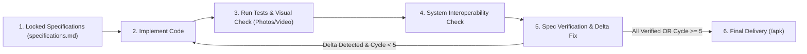

# Antigravity & AI Agent Rule: Iterative Development & Verification Loop

## Overview
This rule governs the development and verification workflow following the Planning Mode Discovery Interview. Once requirements are solidified into a detailed Markdown specifications file (`specifications.md`), implementation MUST proceed in an **Iterative Loop** that combines code generation, automated testing, visual inspection (screenshots and recordings), and deep system interoperability validation.

---

## 🔄 The Iterative Cycle

Each cycle consists of four sequential phases:

### 1. Focused Implementation
- Implement the feature batch in strict accordance with `specifications.md` and `development-standards.md`.
- Keep changes modular, concise, and focused strictly on the acceptance criteria. Do not introduce unrequested abstractions or features.

### 2. Rigorous Testing & Visual Verification
- **Automated Tests**: Execute unit tests, linting, and instrumentation to verify business logic and state transitions.
- **Visual Inspection (Screenshots & Recordings)**:
  - Run the application on an emulator or connected device.
  - Capture screenshots (`adb exec-out screencap -p > <path>.png`) or screen recordings (`adb shell screenrecord ...`) of the updated screens and flows.
  - Inspect the visual captures using file viewing tools to ensure 100% adherence to Material 3 Expressive guidelines:
    - Zero hardcoded colors; correct pairing of container and `on<Role>` tokens.
    - Proper surface container tonal hierarchy (no artificial drop shadows).
    - Accurate typography (Roboto Flex, standard 15 M3 roles), padding (8dp grid), and shape curvature.
    - Smooth interactive transitions (spring physics).

### 3. Deep System Interoperability & OS Interaction Check
Thoroughly test how the application interacts with the Android OS ecosystem and other installed applications:
- **System Intents & Sharing**: Verify `ACTION_SEND`, `ACTION_VIEW`, system share sheets, and deep links. Ensure null/cancellation results are handled gracefully.
- **File Providers & Content Pickers**: Verify URI permissions, Photo Picker, document storage access, and secure file sharing with external apps.
- **Notifications & Background Tasks**: Verify notification channels, heads-up notifications, action buttons, and PendingIntent navigation back stacks.
- **Hardware & Device Capabilities**: Verify permissions flow (contextual requests, graceful fallback if rejected by the user).
- **Configuration & Lifecycle Resilience**: Verify that screen rotation, process death, and the system back gesture (Predictive Back) do not crash the app or lose user input state (`rememberSaveable` / `SavedStateHandle`).

### 4. Specification Compliance & Delta Fix
- Systematically check every requirement in `specifications.md` against test and visual evidence.
- If a regression, visual flaw, or functional gap is detected, document the exact delta and resolve it in the subsequent cycle.

---

## ⏱️ Loop Guards & Optimization Rules

1. **Hard Limit of 4 to 5 Cycles (Infinite Loop Prevention)**:
   - The iterative development loop must **NEVER exceed 5 cycles**.
   - If minor edge-case discrepancies remain at cycle 5, conclude the iteration, document the remaining non-blocking items, and present the current build and APK to the user for guidance.
2. **Ruthless Optimization for Speed**:
   - Each cycle must be tight and direct. Target convergence within **1 to 2 cycles** wherever possible.
   - Batch closely related fixes together rather than running a complete cycle for trivial one-line tweaks.
   - Avoid speculative rewrites, out-of-scope refactoring, or repeating passed tests needlessly.
3. **Delivery Evidence**:
   - At the conclusion of the loop, output the versioned APK path in `/apk/` along with SHA256, alongside summary evidence of passed tests and visual verification.
