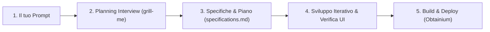

# ✨ Spark! — Il Framework AI per App Android Su Misura

> **Proposta per il Linux Day 2026**  
> Di **[Leonardo Maistrello](https://github.com/leonardo-mais)** (UI & UX) e **[Andrea Sorge](https://github.com/Sorgandri03)** (Architecture & Build)

---

## 🤔 Il Problema: perché le app sugli store spesso ci deludono?

Vi è mai capitato di rimanere delusi dalla qualità delle applicazioni presenti sugli store? Spesso sono esteticamente trascurate, con poche funzioni, oppure non rispondono davvero a ciò di cui abbiamo bisogno.

Facciamo un esempio pratico: supponiamo di voler creare il nostro **ricettario digitale** personale. I nostri requisiti sono chiari:
- **100% gratuita** e **senza pubblicità**
- **100% offline** (nessun obbligo di creare account o fare login per accedere ai *nostri* dati)
- **Ricalcolo automatico delle dosi** in base al numero di persone
- **Esportazione e backup immediati** in formati aperti, per non restare mai bloccati (*vendor lock-in*) se un giorno volessimo cambiare app

Se guardiamo a cosa offre oggi il panorama Android — tra soluzioni come *Deglaze* o *Cooklang* — ci scontriamo quasi sempre con gli stessi limiti:
1. **Pubblicità invasiva o abbonamenti** per funzioni base.
2. **Account obbligatori e cloud proprietari** per utilizzare dati che dovrebbero restare nostri.
3. **Design poco curato**, lontano dagli standard moderni di Android.
4. **Difficoltà di backup ed esportazione** dei dati.
5. **Impossibilità di aggiungere nuove funzioni**: questo è l'aspetto più critico. Un'app tradizionale è chiusa, scritta in un unico modo e non pensata per essere rimodellata dall'utente. E anche quando il progetto è *open-source*, difficilmente si ha il tempo o la voglia di studiare un'intera codebase e mantenere un fork solo per aggiungere una funzione alla propria app di cucina.

---

## ⚡ La Soluzione: Cos'è Spark!?

**Spark!** è un **framework e template AI-first** per sviluppare applicazioni Android belle, complete e funzionali partendo da un semplice prompt.

- 🎨 **Material 3 Expressive + Tocco Personale**: si basa sull'ultimissimo design system *Material 3 Expressive* di Google (con font variabile *Google Sans Flex* offline, fisica a molla, superfici tonali dinamiche e due archetipi visivi: **Classic** e **Impact**), arricchito da un'identità estetica e UX curata nei minimi dettagli.
- 🤖 **Libertà di scelta del modello AI**: Spark! è agnostico rispetto all'agente o al modello AI utilizzato. Puoi usare il tuo assistente AI preferito per generare, modificare o espandere l'app su misura per te.
- 📦 **Pronto all'uso**: essendo un template GitHub, basta clonarlo o cliccare su *"Use this template"*, aprirlo nel proprio ambiente e iniziare subito a dialogare con l'AI per dare vita alla propria applicazione.

---

## 🧠 Come funziona l'Architettura di Spark!

Il cuore del framework risiede nel sistema di istruzioni, regole e competenze per gli agenti AI (orchestrato a partire da [`AGENTS.md`](./AGENTS.md) e strutturato in `.agents/`), che poggia su tre pilastri fondamentali:

### 1. `skills-main` (Le Skill Ufficiali di Android)
È il repertorio ufficiale rilasciato da Google per le AI (integrato in `.agents/skills/`, vedi [`ATTRIBUTION.md`](./.agents/skills/ATTRIBUTION.md)). Contiene la documentazione tecnica aggiornata sui componenti, le API e le interazioni moderne di Android (Navigation 3, Compose Performance, Adaptive Layouts, CameraX, LiteRT, ecc.).  
Tuttavia, presa da sola, questa raccolta è **pura restituzione di dati**: fornisce le firme dei metodi e le API corrette, ma *non* insegna all'AI come progettare un'applicazione bella, coerente e ben architettata.

### 2. `skills` (Le Skill Custom di Spark!)
Sono le competenze progettate da noi che fanno da ponte tra l'idea dell'utente e i componenti ufficiali di Android presenti in `skills-main`:
- Puntano direttamente alle API ufficiali di Android per **azzerare le allucinazioni** del modello AI.
- Impongono le **nostre regole di stile, architettura e UX**.
- Tra le skill principali troviamo:
  - **`spark-jetpack`**: il design system completo Material 3 Expressive, la tipografia parametrica, le palette semantiche HCT e i componenti custom di Spark!.
  - **`spark-wear`**: il workflow per estendere l'app anche su smartwatch **Wear OS** (Companion o Standalone) con sincronizzazione bidirezionale.
  - **`grill-me`** & **`plan`**: il motore di intervista interattiva e di generazione delle specifiche tecniche.
  - **`agent-builder`**: l'automazione per il rilascio continuo e la distribuzione self-hosted.

### 3. `rules` (Le Regole Invarianti per gli Agenti)
Dentro [`.agents/rules/`](./.agents/rules/) risiedono le direttive obbligatorie che guidano il comportamento dell'AI in ogni istante:
- **`planning-interview.md`** (*Planning Interview*): prima di scrivere una sola riga di codice, l'agente avvia un'intervista mirata. Le domande vengono generate dinamicamente in base al tipo di applicazione richiesta nel prompt e servono a chiarire all'AI ogni dettaglio (funzionalità MVP, modello dati offline-first, flussi UX, stile visivo *Classic* vs *Impact* e canale di distribuzione).
- **`development-standards.md`**: definisce gli standard non negoziabili di architettura (Clean Architecture + MVI, Room offline-first, Navigation 3 type-safe, Predictive Back, zero stringhe o colori hardcoded).
- **`iterative-development-loop.md`**: obbliga l'agente a sviluppare il progetto per *milestone*, verificando ogni passo con test automatici, ispezione visiva su emulatore/dispositivo e controlli di interoperabilità con il sistema Android.
- **`agent-builder.md`**: governa l'agente costruttore/rilasciatore che compila, testa, firma l'APK e pubblica gli aggiornamenti in automatico.
- **`planning-wear-interview.md`**: guida la progettazione di eventuali moduli companion per smartwatch Wear OS (attivata esclusivamente su richiesta esplicita).

---

## 🚀 Dal Prompt all'App: Il Flusso di Lavoro



1. **Scarica il template**: crea una nuova repository da questo template su GitHub e aprila con il tuo agente AI.
2. **Esprimi la tua idea**: scrivi un semplice prompt (es. *"Voglio creare un ricettario digitale offline con ricalcolo delle dosi ed esportazione JSON"*).
3. **Rispondi all'intervista dell'Agente**: gli agenti di Spark! ti faranno domande specifiche una alla volta per capire esattamente cosa hai in mente, fino alla scelta dello stile estetico (**Classic** o **Impact**).
4. **Approva il piano**: l'AI genera il documento [`specifications.md`](./specifications.md) e la roadmap di sviluppo.
5. **Costruzione e rilascio automatico**: l'AI scrive il codice seguendo le *skills* e le *rules*, esegue i test e genera l'APK firmato pronto da installare o aggiornare con un tap tramite **Obtainium** (via GitHub Releases o server self-hosted).

---

## 🛠️ Comandi Rapidi di Build e Rilascio

Il progetto include l'agente di rilascio `./release-agent` (wrapper di [`scripts/release.sh`](./scripts/release.sh)) che gestisce versionamento semantico, test unitari, firma crittografica v2 e generazione del feed per **Obtainium**:

```bash
# Eseguire i test unitari
./gradlew testDebugUnitTest

# Compilare l'APK di debug (output in apk/)
./gradlew assembleDebug

# Rilasciare una nuova versione firmata (patch, minor o major)
./release-agent patch -m "Descrizione delle novità"
```

Per tutti i dettagli sulla configurazione del server self-hosted e di Obtainium, consulta [`RELEASE.md`](./RELEASE.md).

---

## 📄 Licenza

Distribuito sotto licenza **Apache License 2.0**. Consulta il file [`LICENSE`](./LICENSE) per maggiori dettagli.
