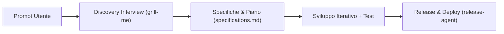

# Spark!

[](https://developer.android.com)
[](https://kotlinlang.org)
[](https://developer.android.com/jetpack/compose)
[](./LICENSE)

**Spark!** è un template e framework AI-first per lo sviluppo di applicazioni Android (e Wear OS) native in Kotlin e Jetpack Compose.  
Fornisce uno scheletro applicativo preconfigurato secondo i principi della Clean Architecture e un sistema strutturato di **Rules** e **Skills** (`.agents/`) che guida qualsiasi agente AI dalla raccolta dei requisiti fino alla compilazione e distribuzione dell'APK firmato.

> Progetto presentato per il **Linux Day 2026** da [Leonardo Maistrello](https://github.com/leonardo-mais) (UI & UX) e [Andrea Sorge](https://github.com/Sorgandri03) (Architecture & Build).

---

## Indice

- [Panoramica](#panoramica)
- [Caratteristiche Principali](#caratteristiche-principali)
- [Architettura del Sistema](#architettura-del-sistema)
- [Struttura della Repository](#struttura-della-repository)
- [Tech Stack](#tech-stack)
- [Getting Started](#getting-started)
- [Build, Test e Release](#build-test-e-release)
- [Autori](#autori)
- [Licenza](#licenza)

---

## Panoramica

I modelli AI generici tendono a produrre codice Android frammentato, con API deprecate o interfacce utente prive di coerenza visiva. **Spark!** risolve questo problema vincolando l'agente AI attraverso tre livelli:

1. **Knowledge Base Ufficiale Android (`.agents/skills/`)**: documentazione tecnica ufficiale Google su Jetpack Compose, Navigation 3, Adaptive UI, CameraX, Room, LiteRT e performance.
2. **Skill Custom di Spark!**: moduli prescrittivi che definiscono il design system *Material 3 Expressive*, il supporto *Wear OS* e la pipeline di rilascio continuo.
3. **Regole Invarianti (`.agents/rules/`)**: vincoli architetturali e procedurali obbligatori (intervista preliminare, sviluppo iterativo per milestone, test unitari e verifica su emulatore).

---

## Caratteristiche Principali

- **AI-Agnostic**: compatibile con qualsiasi coding agent che supporti file di istruzioni nel workspace (`AGENTS.md`).
- **Material 3 Expressive Design System**:
  - Tipografia variabile basata su *Google Sans Flex* (incluso offline in `res/font`).
  - Palette semantiche HCT con supporto completo a Dynamic Color (Android 12+) e contrasto adattivo.
  - Due archetipi visivi selezionabili in fase di setup: **Classic** (sobrio e ad alta densità informativa) e **Impact** (espressivo, con fisica a molla `MotionScheme` e superfici hero).
- **Offline-First & Zero Lock-in**: persistenza locale tramite Room con esportazione/importazione nativa in formati aperti (JSON/CSV).
- **Clean Architecture + MVI**: separazione rigorosa tra `domain`, `data` e `ui`, stato immutabile (`StateFlow`) ed effetti one-shot (`Channel`).
- **Supporto Wear OS Opzionale**: skill e regole dedicate (`spark-wear`) per generare un modulo `:wear` companion o standalone sincronizzato via Wearable Data Layer API.
- **Release Automation & Obtainium**: script integrato (`./release-agent`) per versionamento semantico, firma APK v2 e generazione automatica del feed JSON per aggiornamenti tramite [Obtainium](https://github.com/ImranR98/Obtainium).

---

## Architettura del Sistema

### 1. Livello Agente (`.agents/`)

Il comportamento dell'AI è regolato dal file di ingresso [`AGENTS.md`](./AGENTS.md), che carica:

| Componente | Percorso | Ruolo |
| :--- | :--- | :--- |
| **Planning Interview** | `.agents/rules/planning-interview.md` | Obbliga l'agente a condurre un'intervista strutturata prima di scrivere codice e a generare [`specifications.md`](./specifications.md). |
| **Development Standards** | `.agents/rules/development-standards.md` | Impone Clean Architecture, MVI, Room, Navigation 3 type-safe, Predictive Back e assenza di valori hardcoded. |
| **Iterative Loop** | `.agents/rules/iterative-development-loop.md` | Divide lo sviluppo in milestone verificabili con build, unit test e controllo UI su emulatore/dispositivo. |
| **Spark Jetpack** | `.agents/skills/spark-jetpack/SKILL.md` | Specifica i 30 stili tipografici M3 Expressive, i token colore HCT e i componenti UI custom. |
| **Spark Wear** | `.agents/skills/spark-wear/SKILL.md` | Guida lo sviluppo opzionale di app Wear OS Material 3 e la sincronizzazione telefono-orologio. |
| **Agent Builder** | `.agents/skills/agent-builder/SKILL.md` | Gestisce la pipeline di build, firma crittografica e pubblicazione per Obtainium. |
| **Android Official Skills** | `.agents/skills/*` | Skill ufficiali Google per API specifiche (`navigation-3`, `adaptive`, `edge-to-edge`, `camerax`, `litert-runtime`, ecc.). |

### 2. Flusso Operativo



---

## Struttura della Repository

```text
Spark!/
├── .agents/
│   ├── rules/                  # Regole obbligatorie per l'agente AI
│   └── skills/                 # Skill custom Spark! + Skill ufficiali Android
├── app/
│   └── src/main/
│       ├── java/com/example/spark/
│       │   ├── data/           # Room DB, DAO, DataStore, Repository impl
│       │   ├── di/             # Moduli Dagger Hilt
│       │   ├── domain/         # Modelli, Repository interface, UseCase
│       │   └── ui/             # Theme M3 Expressive, Componenti, Schermate MVI
│       └── res/                # Font (Google Sans Flex), stringhe, risorse XML
├── gradle/
│   └── libs.versions.toml      # Version Catalog centralizzato
├── scripts/
│   ├── release.sh              # Script di build, versioning, firma e deploy
│   └── obtainium-server.py     # Server HTTP locale per distribuzione Obtainium
├── AGENTS.md                   # Entrypoint di configurazione per gli agenti AI
├── RELEASE.md                  # Documentazione della pipeline di rilascio
├── release-agent               # CLI wrapper per il rilascio automatico
└── specifications.md           # Specifiche tecniche dell'applicazione generata
```

---

## Tech Stack

- **Linguaggio**: Kotlin `2.0.21` (Coroutines, Flow, Kotlinx Serialization)
- **UI Framework**: Jetpack Compose (`BOM 2024.12.01`) + Material 3 Expressive (`1.4.0-alpha10`)
- **Architettura**: Clean Architecture + MVI (Model-View-Intent)
- **Dependency Injection**: Dagger Hilt `2.51.1` + KSP
- **Navigazione**: Jetpack Navigation 3 (`1.0.0`) type-safe + Predictive Back
- **Persistenza Locale**: Jetpack Room `2.6.1` + Preferences DataStore
- **Background**: WorkManager `2.10.0`
- **Testing**: JUnit 4, Kotlinx Coroutines Test, Turbine, Compose UI Test
- **Build System**: Gradle `8.9.1` (Kotlin DSL + Version Catalog)

---

## Getting Started

### Prerequisiti

- **JDK 17** o superiore
- **Android SDK** (API 35 / Android 15, minSdk 26)
- Un ambiente o assistente AI compatibile con le regole di workspace (`AGENTS.md`)

### Utilizzo del Template

1. **Crea la repository**: clicca su **"Use this template"** su GitHub oppure clona il progetto:
   ```bash
   git clone https://github.com/<tuo-username>/spark.git
   cd spark
   ```
2. **Avvia il tuo Agente AI**: apri la cartella del progetto nel tuo IDE/agente e descrivi l'applicazione che vuoi realizzare:
   > *"Voglio creare un ricettario digitale offline con ricalcolo automatico delle dosi per porzione ed esportazione JSON."*
3. **Rispondi all'intervista di pianificazione**: l'agente definirà con te le funzionalità MVP, il modello dati, i flussi di navigazione e lo stile visivo (**Classic** o **Impact**).
4. **Approva il piano**: una volta generato e approvato [`specifications.md`](./specifications.md), l'agente implementerà l'app milestone dopo milestone.

---

## Build, Test e Release

### Comandi Gradle Standard

```bash
# Eseguire gli unit test
./gradlew testDebugUnitTest

# Compilare l'APK di debug (copiato automaticamente in apk/)
./gradlew assembleDebug
```

### Rilascio con `release-agent`

Lo script `./release-agent` incrementa automaticamente `versionCode` e `versionName`, esegue i test, compila e firma l'APK in modalità release e aggiorna `version.json` per Obtainium:

```bash
# Rilascio patch (es. 0.1.0 -> 0.1.1)
./release-agent patch -m "Fix calcolo proporzioni ingredienti"

# Rilascio minor (es. 0.1.1 -> 0.2.0)
./release-agent minor -m "Aggiunto export JSON e filtri categorie"

# Rilascio major (es. 0.2.0 -> 1.0.0)
./release-agent major -m "Prima release stabile"
```

Per configurare il keystore di firma, il server self-hosted (Caddy + Tailscale) e Obtainium, consulta [`RELEASE.md`](./RELEASE.md).

---

## Autori

- **Leonardo Maistrello** — *UI, UX & Design System* — [@leonardo-mais](https://github.com/leonardo-mais)
- **Andrea Sorge** — *Architecture, Build & Release Pipeline* — [@Sorgandri03](https://github.com/Sorgandri03)

---

## Licenza

Distribuito sotto licenza **Apache License 2.0**. Vedi il file [`LICENSE`](./LICENSE) per il testo completo.  
Le skill ufficiali Android in `.agents/skills/` sono soggette alle rispettive licenze indicate in [`.agents/skills/ATTRIBUTION.md`](./.agents/skills/ATTRIBUTION.md).
