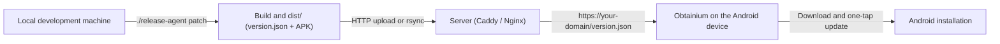

# Continuous Release & Self-Hosted Distribution (Obtainium)

This guide describes the automated release system. It works with any self-hosted HTTP or HTTPS endpoint, and with [Obtainium](https://github.com/ImranR98/Obtainium), an open-source Android app that installs and updates apps directly from their sources.

---

## 1. How the Obtainium integration works

> [!NOTE]
> **What is Obtainium?**
> Obtainium is an open-source Android app. It downloads and updates apps from their sources (GitHub, GitLab, HTML pages, or JSON feeds), without the Google Play Store.
>
> The server does not run an "Obtainium" container. It runs a lightweight web server (Caddy or Nginx) that serves the `dist/` folder, which contains the `version.json` feed and the signed APK files.



---

## 2. Using the release agent

Run the agent from the project root:

```bash
# 1. Patch release (for example 1.0.1 -> 1.0.2)
./release-agent patch -m "Fix contrast and reduce memory use"

# 2. Minor release (for example 1.0.2 -> 1.1.0)
./release-agent minor -m "Add charts and new screens"

# 3. Major release (for example 1.1.0 -> 2.0.0)
./release-agent major -m "New architecture and multi-profile support"

# 4. Explicit version
./release-agent 1.5.0 -m "Milestone release"

# 5. Dry run: print the computed changes, change nothing
./release-agent patch --dry-run
```

### Arguments and flags

| Flag | Description |
|---|---|
| `patch` / `minor` / `major` | Increments the matching semver part and increases `versionCode` by 1 |
| `<X.Y.Z>` | Forces an explicit version (for example `2.1.0`) |
| `-m, --notes "..."` | Release notes, written to `version.json` |
| `--skip-tests` | Skips the unit tests before the build |
| `--no-deploy` | Skips the remote upload, even when `.env` is configured |
| `--dry-run` | Computes and prints the changes without writing files or building |

---

## 3. Generated artifacts

After each run, the folders contain:

- `apk/<AppName>-v<version>-b<build>-release.apk`: the signed APK, for local use.
- `dist/<appSlug>/<AppName>-v<version>-b<build>-release.apk`: the versioned APK, with a `.sha256` file.
- `dist/<appSlug>/<AppName>-latest.apk`: a copy with a fixed name, for direct links.
- `dist/<appSlug>/version.json`: the feed that Obtainium reads.
- `dist/<appSlug>/index.html`: the landing page, with the download button and the Obtainium instructions.

### Structure of `version.json`

```json
{
  "name": "MyApp",
  "slug": "my-app",
  "version": "1.0.1",
  "versionCode": 2,
  "apkUrl": "MyApp-v1.0.1-b2-release.apk",
  "latestApkUrl": "MyApp-latest.apk",
  "sha256": "<sha256-of-the-apk>",
  "sizeBytes": 12313197,
  "releaseNotes": "Fix contrast and reduce memory use",
  "publishedAt": "2026-01-01T00:00:00Z"
}
```

---

## 4. Server configuration with Docker

Create a folder on the server (for example `releases/`) with these four files:

1. `docker-compose.yml`
2. `Caddyfile`
3. `uploader.py`: a small server-side script that receives the uploads and extracts them into the served folder. It is not part of this repository.
4. `.env`: the upload token for the uploader.

### `docker-compose.yml`

```yaml
services:
  caddy-releases:
    image: caddy:2-alpine
    container_name: releases-caddy
    restart: unless-stopped
    ports:
      - "3200:80"
    volumes:
      - ./Caddyfile:/etc/caddy/Caddyfile:ro
      - ./dist:/srv/releases
    depends_on:
      - uploader

  uploader:
    image: python:3.11-alpine
    container_name: releases-uploader
    restart: unless-stopped
    environment:
      - UPLOAD_TOKEN=${UPLOAD_TOKEN:-change_me_to_a_long_random_token}
      - RELEASE_DIR=/srv/releases
      - PORT=8000
    volumes:
      - ./uploader.py:/app/uploader.py:ro
      - ./dist:/srv/releases
    command: python3 /app/uploader.py
```

### `Caddyfile`

```caddy
:80 {
    root * /srv/releases

    # Forward upload requests to the uploader container
    handle /upload* {
        reverse_proxy uploader:8000
    }

    # CORS headers
    header {
        Access-Control-Allow-Origin *
        Access-Control-Allow-Methods "GET, HEAD, POST, OPTIONS"
        Access-Control-Allow-Headers "Authorization, Content-Type, User-Agent"
    }

    # Do not cache the JSON feed, so Obtainium sees new versions immediately
    @versionJson path /version.json
    header @versionJson Cache-Control "no-cache, no-store, must-revalidate"

    @apk path *.apk
    header @apk Content-Type "application/vnd.android.package-archive"

    handle {
        file_server browse
    }
}
```

### Start the server

```bash
docker compose up -d
```

---

## 5. Local configuration (`.env`)

Create a `.env` file in the project root from `.env.example`. The file is git-ignored.

```ini
# Base URL of the distribution server (private network, VPN, or public domain)
SERVER_URL=http://<your-server-address>:3200

# Upload endpoint
UPLOAD_ENDPOINT=http://<your-server-address>:3200/upload

# Bearer token, identical to the uploader configuration on the server
UPLOAD_TOKEN=<your-long-random-token>

# Deployment method
DEPLOY_METHOD=http
```

Then run the release:

```bash
./release-agent patch -m "New version with fixes"
```

The agent then:

1. Increments the semver version and the `versionCode`.
2. Runs the unit tests.
3. Builds the signed release APK.
4. Writes the artifacts to `dist/<appSlug>/`.
5. Uploads the package to `${SERVER_URL}/upload` as a streamed archive.
6. The server extracts the files, and Caddy serves them at `http://<your-server-address>:3200/`.

Never commit `.env` or the token. See `.agents/rules/development-standards.md`, section 9.

---

## 6. Setup in Obtainium on Android

With the Android device on the same network, or on the private network:

1. Open Obtainium and tap **Add App (+)**.
2. In **App source URL**, enter `http://<your-server-address>:3200/<appSlug>/version.json`.
3. Choose **Custom (JSON)** as the source, or **HTML** with `http://<your-server-address>:3200/<appSlug>/`.
4. Tap **Add**.
5. Obtainium shows the app card with the current version, the release notes, and an **Install** button. For each new release, Obtainium notifies you and you can install the update in one tap.
