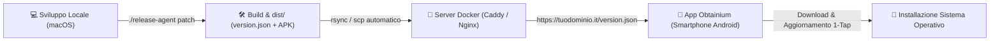

# 🚀 Guida al Rilascio Continuo & Self-Hosted (Obtainium)

Questa guida illustra il sistema di rilascio automatizzato per **AuraStanza**, compatibile con qualsiasi endpoint self-hosted HTTP/HTTPS e con il gestore di pacchetti Android **Obtainium**.

---

## 📌 1. Come Funziona l'Integrazione con Obtainium

> [!NOTE]
> **Cos'è Obtainium?**
> Obtainium è un'applicazione Android open-source che installi sul tuo smartphone. Permette di scaricare e aggiornare automaticamente le app direttamente dalle loro sorgenti ufficiali (GitHub, GitLab, siti web HTML o feed JSON dedicati), bypassando il Google Play Store.
>
> Sul tuo server non gira un container "Obtainium", bensì un **server web leggero (Caddy o Nginx)** che espone la cartella `dist/` contenente il file `version.json` e gli APK firmati.



---

## ⚡ 2. Utilizzo dell'Agente di Release (`release-agent`)

L'agente di release è accessibile tramite il comando `./release-agent` (o `./scripts/release.sh`) alla radice del progetto.

### Comandi Rapidi:

```bash
# 1. Rilascio di una Patch (es. da 1.0.1 a 1.0.2)
./release-agent patch -m "Correzione contrasto M3 e ottimizzazione Room"

# 2. Rilascio di una Minor (es. da 1.0.2 a 1.1.0)
./release-agent minor -m "Aggiunta grafici consumo istantaneo e nuovi scenari"

# 3. Rilascio di una Major (es. da 1.1.0 a 2.0.0)
./release-agent major -m "Nuova architettura e supporto multi-abitazione"

# 4. Rilascio con Versione Esplicita
./release-agent 1.5.0 -m "Versione milestone"

# 5. Simulazione senza modifiche (Dry-Run)
./release-agent patch --dry-run
```

### Parametri e Flag:
| Flag | Descrizione |
|---|---|
| `patch` / `minor` / `major` | Incrementa il relativo segmento semver e incrementa `versionCode` di 1 |
| `<X.Y.Z>` | Forza una versione specifica (es. `2.1.0`) |
| `-m, --notes "..."` | Note di rilascio / changelog salvate in `version.json` |
| `--skip-tests` | Salta l'esecuzione dei test unitari prima del build |
| `--no-deploy` | Salta la sincronizzazione remota (anche se configurata in `.env`) |
| `--dry-run` | Calcola e visualizza le modifiche senza scrivere file o avviare il build |

---

## 📦 3. Artefatti Generati nella Cartella `dist/`

Al termine di ogni esecuzione, la cartella `dist/` contiene:
* `version.json`: File di tracking consumato da Obtainium per rilevare gli aggiornamenti.
* `AuraStanza-v<versione>-b<build>-release.apk`: APK firmato e pronto all'uso con crittografia v2 scheme.
* `AuraStanza-latest.apk`: Copia identica con nome statico persistente per link diretti.
* `index.html`: Landing page web dal design Material You con pulsante di download diretto e guida Obtainium.
* `*.sha256`: Checksum di integrità per ogni APK generato.

### Struttura di `version.json`:
```json
{
  "name": "AuraStanza",
  "version": "1.0.1",
  "versionCode": 2,
  "apkUrl": "AuraStanza-v1.0.1-b2-release.apk",
  "latestApkUrl": "AuraStanza-latest.apk",
  "sha256": "c01dc7f1ea8083eebf278e76406be0216533e1d4084e2ba515ff46ed5f6def26",
  "sizeBytes": 12313197,
  "releaseNotes": "Correzione contrasto M3 e ottimizzazione Room",
  "publishedAt": "2026-10-14T16:21:28Z"
}
```

---

## 🐳 4. Configurazione del Server con Docker (Tailscale HTTP Port 3200)

Nella cartella del tuo server (ad es. `Obtanium/release/aurastanza/` come da screenshot):

### File Richiesti nella cartella del server:
1. `docker-compose.yml`
2. `Caddyfile`
3. `uploader.py`
4. `.env`
Esempio di configurazione pronta all'uso per il server:

#### `docker-compose.yml`:
```yaml
services:
  caddy-releases:
    image: caddy:2-alpine
    container_name: aurastanza-releases
    restart: unless-stopped
    ports:
      - "3200:80"
    volumes:
      - ./Caddyfile:/etc/caddy/Caddyfile:ro
      - ./dist:/srv/releases
    depends_on:
      - uploader

  uploader:
    image: python:3.11-alpine
    container_name: aurastanza-uploader
    restart: unless-stopped
    environment:
      - UPLOAD_TOKEN=${UPLOAD_TOKEN:-your_secure_bearer_token}
      - RELEASE_DIR=/srv/releases
      - PORT=8000
    volumes:
      - ./uploader.py:/app/uploader.py:ro
      - ./dist:/srv/releases
    command: python3 /app/uploader.py
```

#### `Caddyfile`:
```caddy
:80 {
    root * /srv/releases

    # Inoltra le richieste di upload al container uploader
    handle /upload* {
        reverse_proxy uploader:8000
    }

    # Header CORS
    header {
        Access-Control-Allow-Origin *
        Access-Control-Allow-Methods "GET, HEAD, POST, OPTIONS"
        Access-Control-Allow-Headers "Authorization, Content-Type, User-Agent"
    }

    # Evita il caching del JSON per notifiche immediate in Obtainium
    @versionJson path /version.json
    header @versionJson Cache-Control "no-cache, no-store, must-revalidate"

    @apk path *.apk
    header @apk Content-Type "application/vnd.android.package-archive"

    handle {
        file_server browse
    }
}
```

#### Avvio sul Server:
```bash
docker compose up -d
```

---

## 🔄 5. Distribuzione Automatica dal Mac via HTTP (.env)

Il file `.env` alla radice del progetto può essere configurato con i parametri per la tua macchina o server remoto:

```ini
# Server HTTP su rete locale, Tailscale o dominio pubblico
SERVER_URL=http://<YOUR_SERVER_IP>:3200

# Endpoint di upload
UPLOAD_ENDPOINT=http://<YOUR_SERVER_IP>:3200/upload

# Bearer Token di sicurezza
UPLOAD_TOKEN=your_secure_bearer_token

# Metodo di deploy
DEPLOY_METHOD=http
```

Ora, lanciando semplicemente:
```bash
./release-agent patch -m "Nuova versione con fix"
```
Il sistema:
1. Incrementa la versione semver e il `versionCode`.
2. Esegue i test unitari.
3. Compila l'APK release firmato.
4. Confeziona gli artefatti in `dist/`.
5. **Invia automaticamente il pacchetto via streaming HTTP al server `http://<YOUR_SERVER_IP>:3200/upload`**.
6. Il server estrae i file e Caddy li rende subito visibili su `http://<YOUR_SERVER_IP>:3200/`.

---

## 📱 6. Configurazione su Obtainium sullo Smartphone Android

Con lo smartphone Android connesso alla stessa rete o Tailscale:

1. Apri **Obtainium** -> tocca **Aggiungi App (+)**.
2. Nel campo **App Source URL**, inserisci:
   ```text
   http://<YOUR_SERVER_IP>:3200/version.json
   ```
3. Seleziona **Custom (JSON)** come sorgente (oppure **HTML** inserendo `http://<YOUR_SERVER_IP>:3200/`).
4. Tocca **Aggiungi**.
5. Obtainium mostrerà la scheda dell'app con versione corrente, changelog e pulsante **Installa**. Ad ogni nuovo rilascio eseguito con `./release-agent`, Obtainium notificherà l'aggiornamento e permetterà l'installazione in 1 tap.
